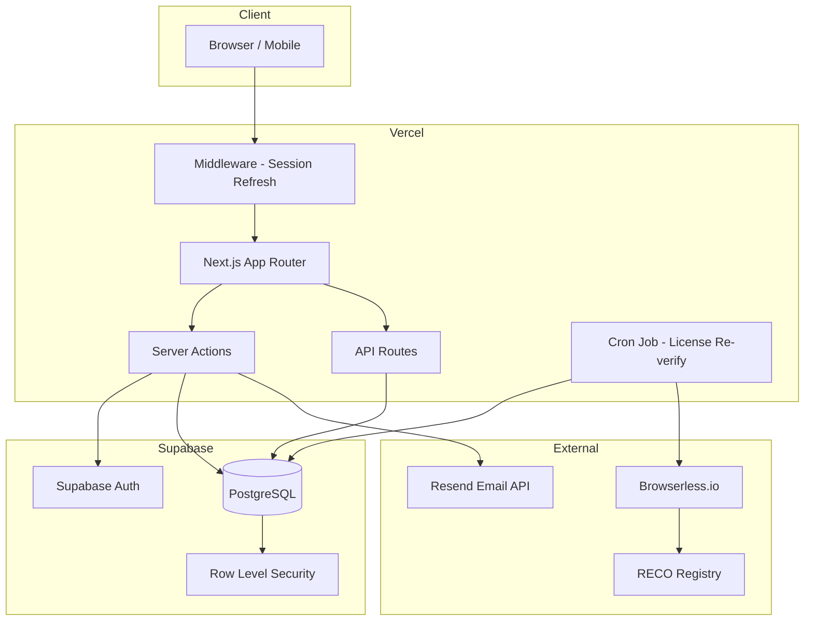

# ViewTO - House Appointment Platform

A modern real estate platform for Toronto that simplifies property viewings. Book appointments directly with landlords, connect with RECO-verified realtors, and find your next home without the back-and-forth.


---

## Overview

ViewTO is a full-stack property viewing scheduler built with Next.js 14 (App Router) and Supabase. It connects three user roles—renters/buyers, landlords, and realtors—through a streamlined booking workflow. The platform integrates with Ontario's Real Estate Council (RECO) public registry for realtor license verification.

---

## Screenshots / Demo

> **TODO:** Add screenshots of the main pages (landing, browse listings, realtor directory, landlord dashboard) or link to a live demo.

---

## Features

### For Renters & Buyers
- **Browse Listings** – Filter properties by price, bedrooms, bathrooms, and listing type (rent/sale)
- **Direct Booking** – Schedule viewings directly with landlords through available time slots
- **Find Realtors** – Connect with RECO-verified real estate professionals
- **Dark/Light Mode** – Theme toggle with persistent preference

### For Landlords
- **Create Listings** – Post properties with images, descriptions, and pricing
- **Set Availability** – Define recurring viewing windows per listing
- **Manage Appointments** – View incoming booking requests and confirm/cancel
- **Hire Realtors** – Assign a verified realtor to manage showings for a listing

### For Realtors
- **RECO Verification** – Automatic license verification against Ontario's RECO database
- **Professional Profiles** – Display license type, brokerage, languages, and hourly rate
- **Client Connections** – Receive and manage hire requests from landlords

### Platform
- **Email Notifications** – Automated emails for booking confirmations (via Resend)
- **Cron-based License Re-verification** – Daily job to re-check realtor license status
- **Responsive Design** – Mobile-first UI with bottom navigation on small screens

---

## Tech Stack

| Layer | Technology |
|-------|------------|
| **Framework** | [Next.js 14](https://nextjs.org/) (App Router, Server Actions) |
| **Language** | [TypeScript](https://www.typescriptlang.org/) |
| **Database** | [Supabase](https://supabase.com/) (PostgreSQL + Row Level Security) |
| **Auth** | Supabase Auth (email/password, magic link) |
| **Styling** | [Tailwind CSS](https://tailwindcss.com/) + [tailwindcss-animate](https://github.com/jamiebuilds/tailwindcss-animate) |
| **Email** | [Resend](https://resend.com/) |
| **Verification** | [Browserless.io](https://browserless.io/) (headless scraping) |
| **Deployment** | [Vercel](https://vercel.com/) |

---

## Architecture



### Data Flow

1. **Authentication** – Middleware refreshes Supabase sessions on every request
2. **Listings & Profiles** – Stored in PostgreSQL with RLS policies per user role
3. **Booking** – Tenant selects a time slot → Server Action creates an appointment → Email sent to landlord
4. **RECO Verification** – On realtor signup, Browserless scrapes RECO; if automatic check fails, admin manually verifies

---

## Project Structure

```
.
├── app/                      # Next.js App Router
│   ├── actions/              # Modular server actions (profile, realtor, etc.)
│   ├── actions.ts            # Core server actions (listings, appointments)
│   ├── api/                  # API routes (cron, verification)
│   ├── auth/callback/        # Supabase auth callback
│   ├── browse/               # Browse listings page
│   ├── become-realtor/       # Realtor onboarding page
│   ├── landlord/[id]/        # Landlord public profile
│   ├── listing/[id]/         # Single listing detail
│   ├── my-listings/          # Landlord dashboard
│   ├── profile/              # User profile & settings
│   ├── realtors/             # Realtor directory
│   ├── admin/verify/         # Admin manual verification
│   ├── layout.tsx            # Root layout with Navbar & ThemeProvider
│   └── page.tsx              # Landing page
├── components/               # React components (modals, cards, forms)
├── lib/                      # Business logic utilities
│   ├── availability.ts       # Time slot generation
│   ├── landlord.ts           # Listing queries
│   └── reco-verification.ts  # RECO license verification logic
├── types/                    # TypeScript interfaces
├── utils/supabase/           # Supabase client helpers (server, client, middleware)
├── supabase/migrations/      # SQL migration files
├── scripts/                  # Utility scripts (seed, ingest)
├── public/                   # Static assets
├── middleware.ts             # Next.js middleware for session refresh
├── tailwind.config.ts        # Tailwind configuration
├── vercel.json               # Vercel cron configuration
└── .env.example              # Environment variable template
```

---

## Getting Started

### Prerequisites

- Node.js 18+
- npm or yarn
- A [Supabase](https://supabase.com/) project
- (Optional) [Resend](https://resend.com/) API key for emails
- (Optional) [Browserless.io](https://browserless.io/) API key for automatic RECO verification

### Installation

```bash
# Clone the repository
git clone https://github.com/your-username/view-to.git
cd view-to

# Install dependencies
npm install
```

### Environment Variables

Copy the example file and fill in your credentials:

```bash
cp .env.example .env.local
```

See [`.env.example`](.env.example) for the full list of variables.

### Database Setup

1. Create a new Supabase project
2. Run the migrations in `supabase/migrations/` in order (or use the Supabase CLI)
3. Enable Row Level Security policies as defined in the migrations

### Running Locally

```bash
# Start the development server
npm run dev
```

Open [http://localhost:3000](http://localhost:3000) in your browser.

### Seeding Sample Data

```bash
npm run seed
```

This populates the database with dummy listings for testing.

---

## Available Scripts

| Script | Description |
|--------|-------------|
| `npm run dev` | Start development server |
| `npm run build` | Build for production |
| `npm run start` | Start production server |
| `npm run lint` | Run ESLint |
| `npm run seed` | Seed database with sample listings |
| `npm run ingest` | Run data ingestion script |

---

## Environment Variables

| Variable | Required | Description |
|----------|----------|-------------|
| `NEXT_PUBLIC_SUPABASE_URL` | Yes | Supabase project URL |
| `NEXT_PUBLIC_SUPABASE_ANON_KEY` | Yes | Supabase anonymous/public key |
| `SUPABASE_SERVICE_ROLE_KEY` | Yes* | Service role key (for seeding/admin) |
| `RESEND_API_KEY` | No | Resend API key for email notifications |
| `BROWSERLESS_API_KEY` | No | Browserless.io key for RECO scraping |
| `CRON_SECRET` | No | Secret to authenticate Vercel cron requests |

*Required for running seed scripts and admin operations.

---

## RECO Verification

The platform verifies realtor licenses against Ontario's [Real Estate Council of Ontario (RECO)](https://www.reco.on.ca/) public registry.

**Verification checks:**
- License status: Active, Suspended, Terminated, Expired, Revoked
- Brokerage registration
- License type: Broker, Salesperson, Broker of Record

**Flow:**
1. Realtor submits their RECO registration number during onboarding
2. System attempts automatic verification via Browserless.io
3. If automatic verification fails, the realtor is marked `PENDING_VERIFICATION` for admin review
4. A daily cron job re-verifies all realtors whose last check is older than 30 days

---

## Deployment

The app is configured for deployment on Vercel:

```bash
# Deploy via Vercel CLI
vercel
```

Set environment variables in the Vercel dashboard. The `vercel.json` includes a cron job that runs daily at 3 AM UTC to re-verify realtor licenses.

---

## License

This project is licensed under the MIT License. See [LICENSE](LICENSE) for details.
